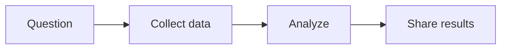

Hi, and welcome to my blog. This first post is also a gallery of the things I can use when writing here. The examples below are illustrative.

## Text and links

A paragraph can include **bold**, *italic*, ~~strikethrough~~, and `inline code`. Here is a link to [Jekyll](https://jekyllrb.com/) and a footnote for an additional thought.[^example]

> A blockquote is useful for highlighting a passage or a thought.

An unordered list:

- Read and collect ideas.
- Make a small example.
  - Add notes and references.
- Share what worked.

A numbered list:

1. Ask a question.
2. Explore the data.
3. Explain the result.

---

## Images

A single image can have descriptive alternative text and a caption:

<figure>
  
  <figcaption>An example landscape illustration. Click the image to zoom in.</figcaption>
</figure>

Two images can also sit side by side:

<div style="display: flex; flex-wrap: wrap; gap: 1rem;">
  <figure style="flex: 1 1 260px; margin: 0;">
    
    <figcaption>A landscape.</figcaption>
  </figure>
  <figure style="flex: 1 1 260px; margin: 0;">
    
    <figcaption>A data illustration.</figcaption>
  </figure>
</div>

## Mathematics

Inline math works like this: the Pythagorean theorem is $$a^2 + b^2 = c^2$$, and Euler's identity is $$e^{i\pi} + 1 = 0$$.

Display equations work too. Here is the Gaussian integral:

$$
\int_{-\infty}^{\infty} e^{-x^2} \, dx = \sqrt{\pi}
$$

And the definition of the derivative:

$$
f'(x) = \lim_{h \to 0} \frac{f(x + h) - f(x)}{h}
$$

## Code

Fenced code blocks support syntax highlighting:

```python
def moving_average(values):
    """Return the mean of a nonempty list."""
    return sum(values) / len(values)

print(moving_average([2, 4, 6]))  # 4.0
```

## Tables

| Method | Example use | Result |
| :--- | :--- | ---: |
| Mean | Summarize values | 4.0 |
| Median | Find the middle value | 4.0 |
| Maximum | Find the largest value | 6.0 |

## Diagram

Mermaid diagrams turn text into a flowchart:



## Chart

This interactive chart uses example data:

```chartjs
{
  "type": "line",
  "data": {
    "labels": ["Monday", "Tuesday", "Wednesday", "Thursday", "Friday"],
    "datasets": [{
      "label": "Example observations",
      "data": [2, 4, 3, 6, 5],
      "borderColor": "#345f78",
      "backgroundColor": "rgba(52, 95, 120, 0.2)",
      "tension": 0.25
    }]
  },
  "options": { "responsive": true }
}
```

## Tabs





```python
print("Hello, world!")
```





```javascript
console.log("Hello, world!");
```





## Expandable details

<details>
  <summary>Click to reveal a note</summary>
  <p>Details sections can hold supplementary explanations without interrupting the main text.</p>
</details>

## More options

The theme can also include video, audio, notebooks, citations, and other specialized content when the corresponding files or services are set up. See the [al-folio example posts](https://github.com/alshedivat/al-folio/tree/main/_posts) for additional formats.

[^example]: Footnotes keep supporting information close at hand without interrupting the main text.
